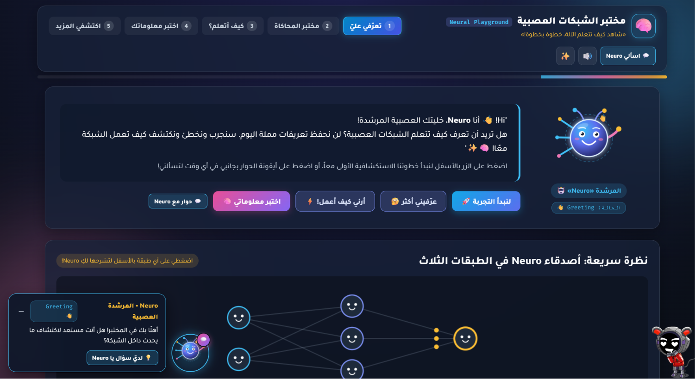
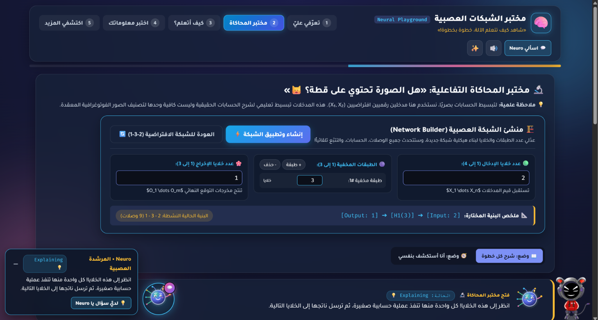
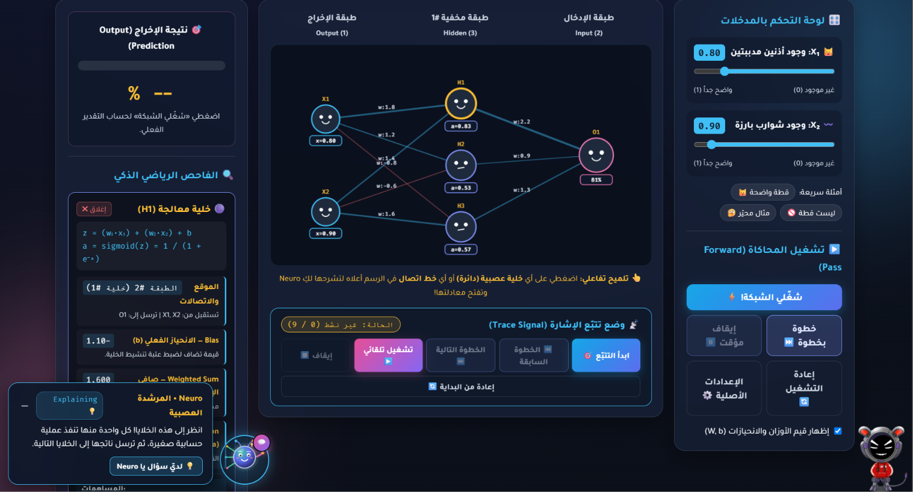
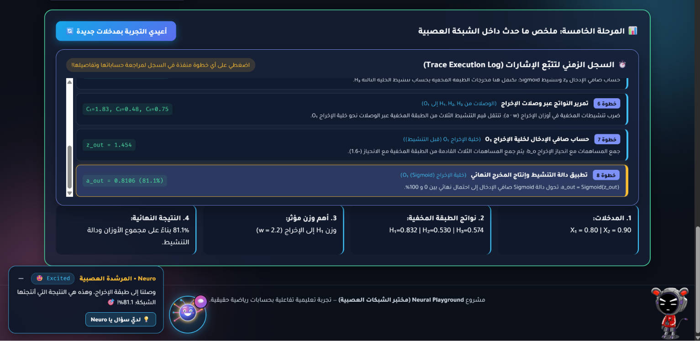
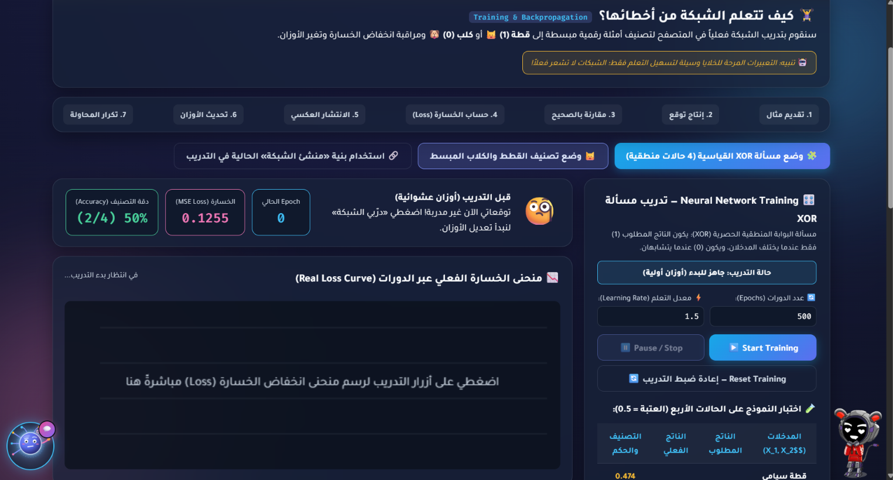
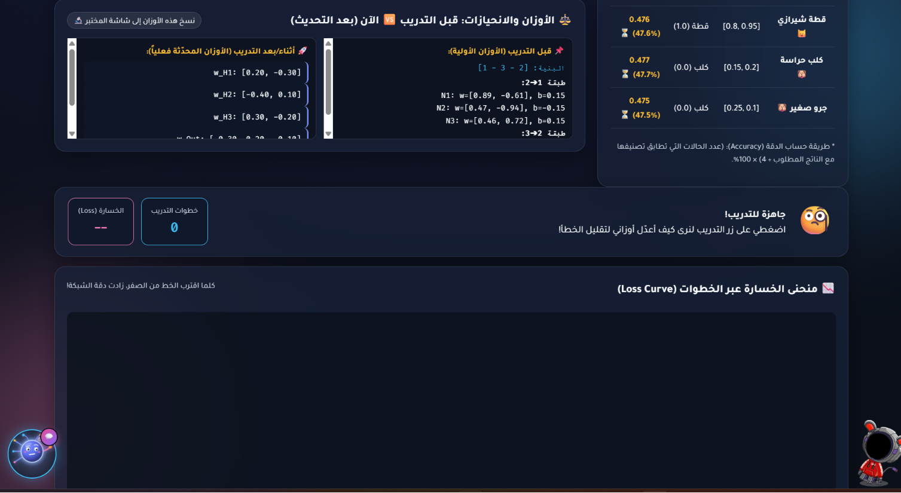
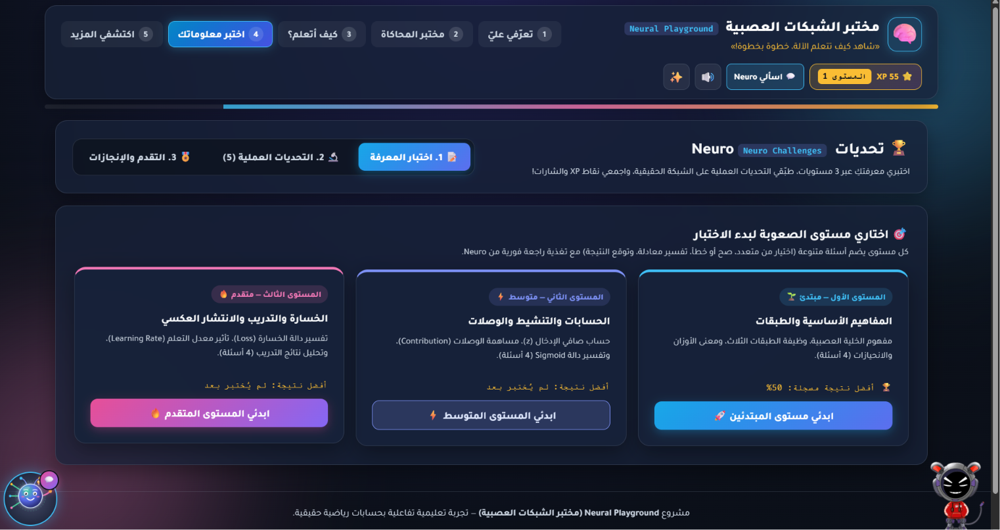
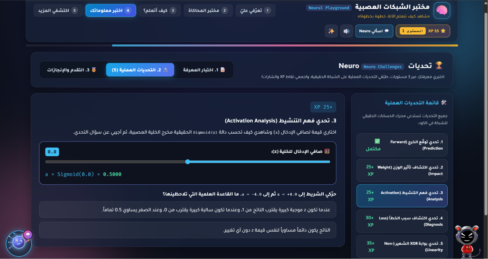
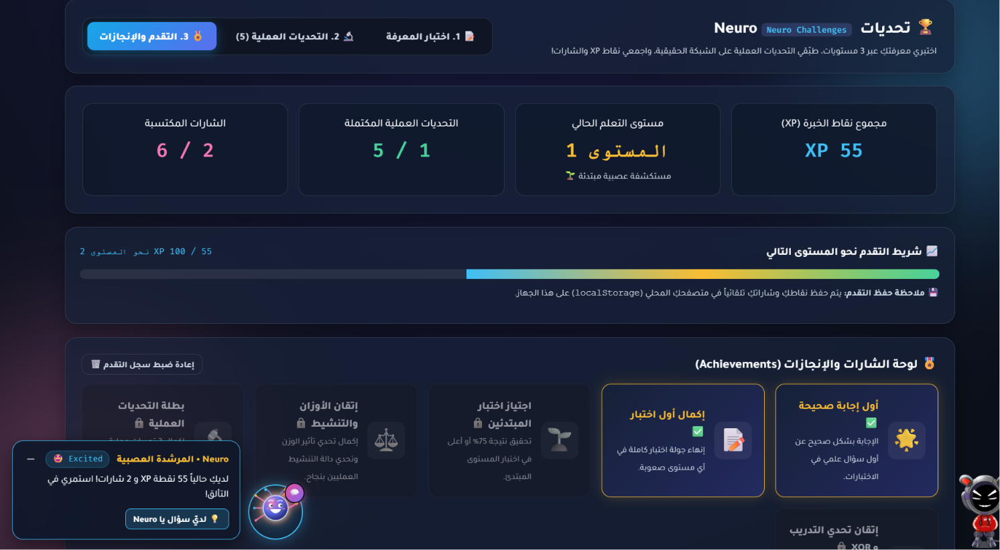
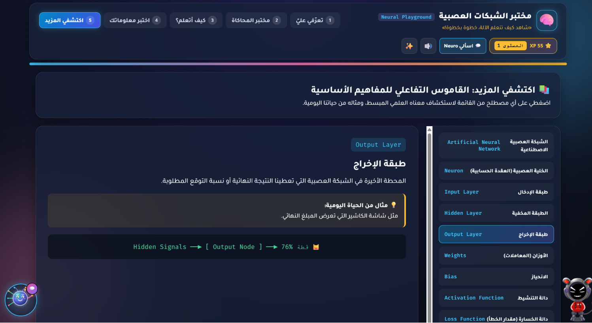

## 📸 Screenshots Gallery

Here is a visual walkthrough of the Neural Playground interface across its core educational modules:

| Welcome & Introduction | Simulation Lab Dashboard |
| :---: | :---: |
|  *The welcoming dashboard featuring the guide Neuro.* |  *The core neural network workspace and interactive controls.* |

| Node & Connection Inspector | Mathematical Step-by-Step Breakdown |
| :---: | :---: |
|  *Detailed mathematical properties of selected nodes.* |  *Step-by-step formulas and live calculations.* |

| Signal Tracing Mode (`Trace Signal`) | Chronological Execution Timeline Log |
| :---: | :---: |
|  *Tracing data flow across layers step-by-step.* |  *Chronological log of execution steps and values.* |

| Training & Backpropagation Module | Live Loss Curve (`Loss Curve`) |
| :---: | :---: |
|  *Training the network on sample classification datasets.* |  *Visualizing loss reduction over training epochs.* |

| Multi-Level Knowledge Quizzes | Interactive Glossary of AI Concepts |
| :---: | :---: |
|  *Multi-level tests with instant feedback and XP rewards.* |  *Interactive dictionary explaining core AI concepts.* |
